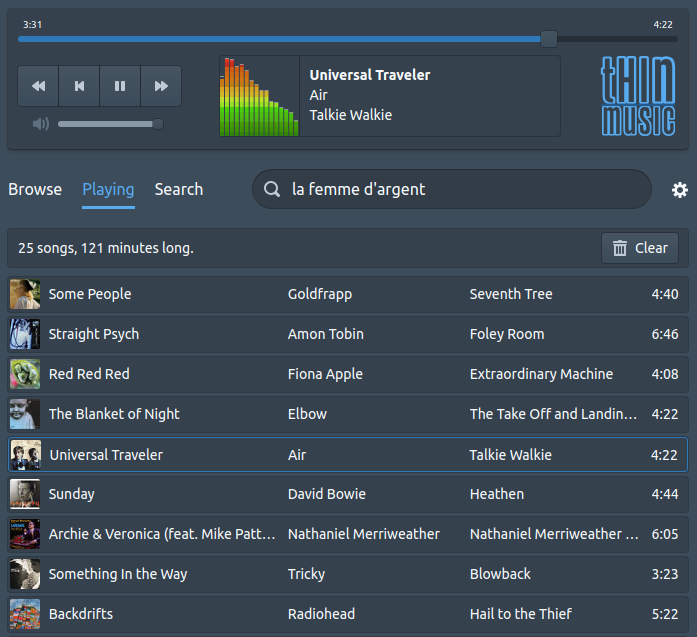

# ThinMusic

https://www.thinmusic.com

A web player for Apple Music with last.fm support

## Credits

Modern web development stands on the shoulders of giants.

- [React](https://react.dev) and [Vite](https://vite.dev)
- [normalize.css](https://necolas.github.io/normalize.css/)
- UI by [Blueprint JS](https://blueprintjs.com)
- Backend in [Firebase](https://firebase.google.com)
- Drag and Drop by [react-beautiful-dnd](https://github.com/atlassian/react-beautiful-dnd)
- Device detection by [react-device-detect](https://github.com/duskload/react-device-detect)
- Visualizer from [Webamp](https://github.com/captbaritone/webamp)
- Last.FM [library](https://github.com/jammus/lastfm-node) in Node

## Development

You need Node 20+ and a [MusicKit](https://developer.apple.com/documentation/musickitjs)
developer token. Put it in `.env.local` as `VITE_MUSICKIT_TOKEN=<token>`, then:

    npm install
    npm run dev

`npm run smoke` builds the site and runs a signed-out smoke test in headless
Google Chrome (browse, search, preview playback, saved volume, queue drag and drop).

## Build

`npm run build` writes the site to `dist/`.

## License

[MIT](https://en.wikipedia.org/wiki/MIT_License)
